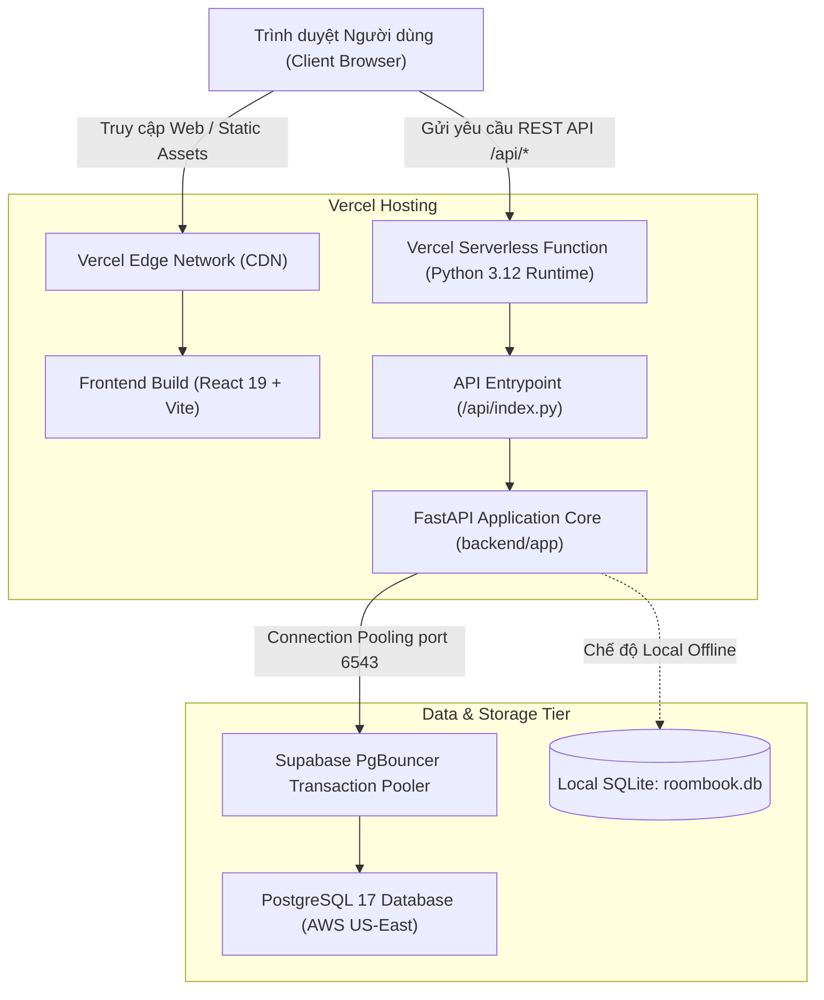
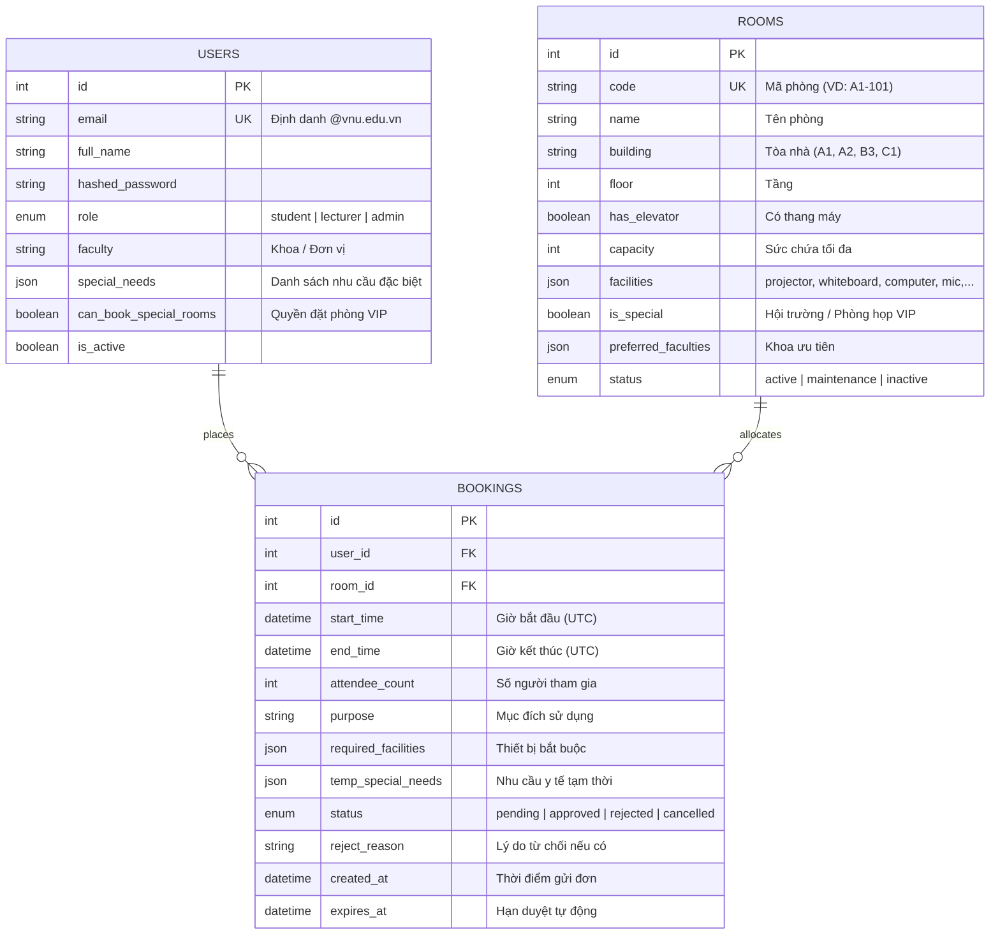
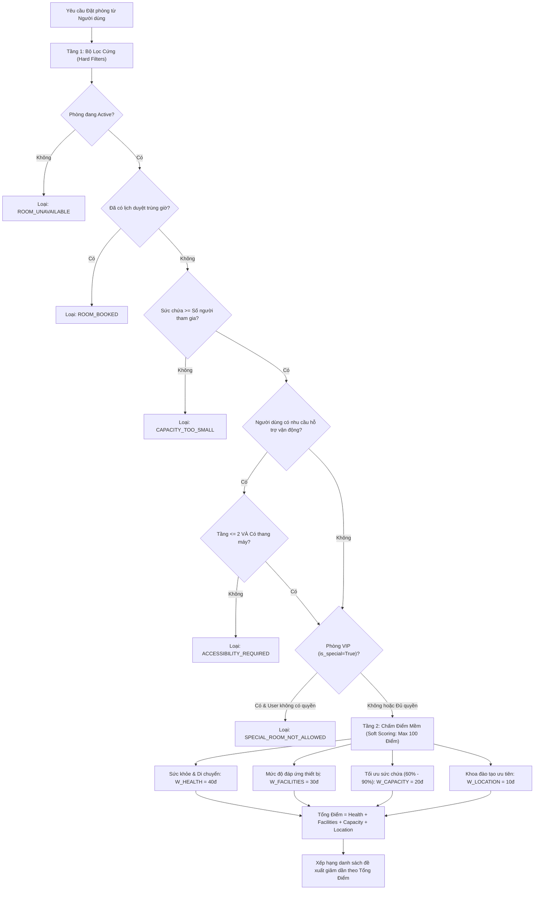

# Tài Liệu Kỹ Thuật Hệ Thống BookIn (VNU-IS)
> **Hệ thống Quản lý, Phê duyệt và Đề xuất Phòng học Thông minh**  
> Đơn vị: Trường Quốc tế – Đại học Quốc gia Hà Nội (VNU-IS)  
> Phiên bản: 1.0.0 Production Ready  
> Nền tảng triển khai: Vercel Serverless Monorepo & Supabase Cloud PostgreSQL

---

## 1. Tổng Quan Kiến Trúc (Architecture Overview)

BookIn là hệ thống quản lý cơ sở vật chất và đặt phòng học trực tuyến phục vụ cán bộ, giảng viên và sinh viên Trường Quốc tế (VNU-IS). Hệ thống được thiết kế theo mô hình **Monorepo** phân tách rõ ràng giữa Single Page Application (SPA) phía Frontend và RESTful API phía Backend, có khả năng vận hành linh hoạt ở cả môi trường phát triển cục bộ (Local Development) và môi trường điện toán đám mây phi máy chủ (Serverless Production).

### Các nguyên tắc kỹ thuật cốt lõi:
1. **Phân quyền chặt chẽ (RBAC)**: Phân định 3 cấp độ người dùng: `student` (Sinh viên), `lecturer` (Giảng viên), `admin` (Quản trị viên / Hội đồng xét duyệt).
2. **Ràng buộc định danh học thuật**: Tất cả tài khoản bắt buộc phải sử dụng email đuôi `@vnu.edu.vn`.
3. **Thuật toán Đề xuất Phòng Tự Động (Smart Recommendation Engine)**: Kết hợp bộ lọc cứng (Hard Filters) và cơ chế chấm điểm mềm (Soft Scoring) tối ưu theo 4 tiêu chí: Nhu cầu vận động/y tế, Trang thiết bị, Tỷ lệ lấp đầy sức chứa, và Vị trí khoa.
4. **Xử lý xung đột thời gian thực**: Phát hiện và ngăn chặn trùng lịch đặt phòng theo khoảng thời gian thực tế `[start_time, end_time)`.
5. **Cơ chế dọn dẹp hàng đợi tự động (Garbage Collection)**: Tự động hủy các đơn đặt phòng ở trạng thái `pending` quá thời hạn quy định (48 giờ) để tránh giữ chỗ ảo.

---

## 2. Công Nghệ Sử Dụng (Tech Stack)

### 2.1. Backend
* **Ngôn ngữ**: Python 3.10+ (triển khai Python 3.12 trên Vercel Serverless).
* **Framework**: [FastAPI 0.162](https://fastapi.tiangolo.com/) – hiệu năng cao, tự động sinh OpenAPI / Swagger UI.
* **ORM & Database Toolkit**: [SQLAlchemy 2.1](https://www.sqlalchemy.org/) – cú pháp Declarative Mapping chuẩn 2.0.
* **PostgreSQL Driver**: `psycopg2-binary 2.9.13` (kết hợp cơ chế làm sạch DSN libpq).
* **Validation & Data Parsing**: [Pydantic v2](https://docs.pydantic.dev/) & `pydantic-settings`.
* **Xác thực & Mã hóa**: `python-jose` (chuẩn hóa JWT Bearer Token), `bcrypt` (băm mật khẩu an toàn).
* **Testing Framework**: `pytest` với 35 kịch bản kiểm thử tự động toàn diện.

### 2.2. Frontend
* **Core Library**: [React 19](https://react.dev/) & React DOM.
* **Ngôn ngữ**: TypeScript 5.7+ (Strict Type Checking).
* **Build Tool**: [Vite 8](https://vitejs.dev/) – tối ưu hoá bundle, thời gian build client ~160ms.
* **Styling**: [Tailwind CSS v4](https://tailwindcss.com/) kết hợp CSS Variables theo phong cách VNU-IS Brand Identity.
* **Server State Management**: [TanStack Query v5 (React Query)](https://tanstack.com/query/latest) – tự động cache, revalidate và đồng bộ trạng thái mạng.
* **Routing**: [React Router v7](https://reactrouter.com/).

### 2.3. Cơ sở hạ tầng & Database
* **Database chính**: Supabase Cloud PostgreSQL 17 (AWS US-East-1).
* **Connection Pooling**: AWS Pooler port 6543 (PgBouncer mode Transaction) giúp ứng dụng Serverless mở/đóng hàng trăm kết nối đồng thời mà không bị cạn kiệt tài nguyên DB connection.
* **Triển khai Production**: Vercel Serverless Monorepo tự động CI/CD khi đẩy mã nguồn lên nhánh `main`.

---

## 3. Thiết Kế Cơ Sở Dữ Liệu (Database Schema)

### 3.1. Bảng `users` (Người dùng)
* Lưu trữ thông tin tài khoản người dùng của toàn hệ thống.
* Trường `special_needs` dạng JSON lưu các nhãn như `["wheelchair"]` (sử dụng xe lăn) hoặc `["leg_injury"]` (chấn thương chân).
* Ràng buộc duy nhất trên trường `email` (Unique Index).

### 3.2. Bảng `rooms` (Phòng học & Giảng đường)
* Quản lý hồ sơ cơ sở vật chất của từng phòng học thuộc các tòa A1, A2, B3, C1.
* Phân loại phòng thường và phòng đặc biệt (`is_special = True`, ví dụ Hội trường B3 hoặc phòng hội thảo cao cấp).
* Lưu trữ mảng `facilities`: `projector` (Máy chiếu), `whiteboard` (Bảng viết), `computer` (Máy tính), `microphone` (Micro/Âm thanh), `video_conference` (Họp trực tuyến), `air_conditioner` (Điều hòa).

### 3.3. Bảng `bookings` (Yêu cầu đặt phòng)
* Lưu trữ vòng đời của từng giao dịch đặt phòng.
* Chỉ mục ghép quan trọng: `ix_bookings_room_time ("room_id", "start_time", "end_time")` tối ưu hoá tốc độ truy vấn kiểm tra trùng lặp lịch.
* Trạng thái đơn gồm:
  * `pending`: Đang chờ Hội đồng xét duyệt xử lý.
  * `approved`: Đã được phê duyệt chính thức (chiếm lịch phòng).
  * `rejected`: Bị từ chối (kèm lý do ghi rõ trong `reject_reason`).
  * `cancelled`: Đơn bị người đặt tự hủy hoặc hệ thống tự hủy do hết hạn chờ duyệt (`expires_at <= now()`).

---

## 4. Thuật Toán Đề Xuất & Chấm Điểm Phòng Học (Smart Recommendation Engine)

Hệ thống tích hợp thuật toán thông minh tại service [`scoring.py`](file:///E:/job/bookin/backend/app/services/scoring.py) chia thành hai tầng xử lý:

### 4.1. Chi tiết Trọng số Chấm điểm Mềm (Tối đa 100 điểm)

$$\text{Total Score} = S_{\text{health}} + S_{\text{facilities}} + S_{\text{capacity}} + S_{\text{location}}$$

1. **Điểm Sức khỏe & Di chuyển ($S_{\text{health}}$ - Tối đa 40 điểm)**:
   * Nếu người dùng không có nhu cầu hỗ trợ vận động: Mặc định nhận trọn **40 điểm**.
   * Nếu người dùng có nhu cầu hỗ trợ (xe lăn, chấn thương chân):
     * Phòng ở **Tầng 1**: Nhận trọn **40 điểm** (thuận tiện di chuyển tối đa).
     * Phòng ở **Tầng 2** và có thang máy: Nhận **20 điểm** ($W_{\text{HEALTH}} / 2$).
     * Các trường hợp còn lại: 0 điểm.

2. **Điểm Trang thiết bị ($S_{\text{facilities}}$ - Tối đa 30 điểm)**:
   * Nếu người dùng không yêu cầu thiết bị nào: Nhận trọn **30 điểm**.
   * Nếu có yêu cầu:
     $$S_{\text{facilities}} = \text{round}\left( 30 \times \frac{|\text{Thiết bị yêu cầu} \cap \text{Thiết bị phòng có}|}{|\text{Thiết bị yêu cầu}|} \right)$$

3. **Điểm Tối ưu Sức chứa ($S_{\text{capacity}}$ - Tối đa 20 điểm)**:
   * Đặt tỷ lệ khai thác $r = \frac{\text{attendee\_count}}{\text{capacity}}$. Ngưỡng tối ưu được xác định từ **60% đến 90%** sức chứa ($0.6 \le r \le 0.9$):
     * Nếu $r < 0.6$: Phòng quá rộng so với số người, gây lãng phí:  
       $$S_{\text{capacity}} = \text{round}\left( 20 \times \frac{r}{0.6} \right)$$
     * Nếu $0.6 \le r \le 0.9$: Đạt tỷ lệ vàng khai thác phòng học $\rightarrow$ Nhận trọn **20 điểm**.
     * Nếu $r > 0.9$: Phòng quá sát sức chứa tối đa:  
       $$S_{\text{capacity}} = \text{round}\left( 20 - \frac{\min(r, 1.0) - 0.9}{1.0 - 0.9} \times 10 \right)$$

4. **Điểm Ưu tiên Vị trí / Khoa ($S_{\text{location}}$ - Tối đa 10 điểm)**:
   * Nếu khoa của người dùng nằm trong danh sách `preferred_faculties` của phòng $\rightarrow$ Nhận **10 điểm**.
   * Ngược lại: 0 điểm.

---

## 5. Danh Sách API Endpoints Chi Tiết

Tất cả các API được bảo vệ yêu cầu Header `Authorization: Bearer <access_token>`.

### 5.1. Xác thực & Tài khoản (`/api/auth`)
* `POST /api/auth/register`: Đăng ký tài khoản. Bắt buộc `email` có đuôi `@vnu.edu.vn`. Payload gồm `email`, `password`, `full_name`, `role`, `faculty`, `special_needs`.
* `POST /api/auth/login`: Đăng nhập bằng `username` (email) và `password` (theo chuẩn OAuth2 Password Request Form). Trả về `access_token` và `token_type: "bearer"`.
* `GET /api/auth/me`: Lấy thông tin phiên làm việc hiện tại của người dùng.

### 5.2. Quản lý Người dùng (`/api/users`)
* `GET /api/users/profile`: Lấy chi tiết hồ sơ cá nhân.
* `PUT /api/users/profile`: Cập nhật thông tin khoa, danh sách nhu cầu đặc biệt (`special_needs`).

### 5.3. Quản lý Phòng học (`/api/rooms`)
* `GET /api/rooms`: Danh sách phòng học kèm bộ lọc động (`building`, `floor`, `min_capacity`, `facilities`, `status`).
* `GET /api/rooms/{id}`: Xem chi tiết một phòng học.
* `POST /api/rooms`: *(Admin)* Tạo phòng học mới.
* `PUT /api/rooms/{id}`: *(Admin)* Cập nhật thông tin phòng.
* `DELETE /api/rooms/{id}`: *(Admin)* Xóa phòng hoặc chuyển trạng thái không hoạt động.

### 5.4. Đặt phòng & Đề xuất (`/api/bookings`)
* `POST /api/bookings/recommendations`: Gửi yêu cầu tìm kiếm phòng, trả về danh sách các phòng hợp lệ được xếp hạng theo điểm số thông minh và danh sách các phòng bị loại kèm lý do chi tiết.
* `POST /api/bookings`: Tạo đơn đặt phòng mới. Hệ thống tự động gán hạn duyệt `expires_at = now() + 48h`.
* `GET /api/bookings/my`: Lấy danh sách lịch sử các đơn đặt phòng của chính người dùng hiện tại.
* `POST /api/bookings/{id}/cancel`: Người dùng tự hủy đơn đặt phòng của mình (nếu đơn chưa diễn ra).

### 5.5. Hội đồng Phê duyệt (`/api/approval`)
* `GET /api/approval/queue`: Lấy danh sách hàng đợi các đơn chờ duyệt. Sắp xếp ưu tiên: **Giảng viên lên trước**, sau đó sắp xếp theo thời gian nộp đơn sớm nhất.
* `POST /api/approval/{id}/approve`: *(Admin)* Phê duyệt đơn đặt phòng. Hệ thống thực hiện kiểm tra xung đột lịch thời gian thực trước khi chốt duyệt.
* `POST /api/approval/{id}/reject`: *(Admin)* Từ chối đơn và lưu trữ lý do phản hồi cho người đặt.

### 5.6. Báo cáo & Thống kê (`/api/reports`)
* `GET /api/reports`: Tổng hợp dữ liệu phân tích hệ thống:
  * `summary`: Thống kê tổng số đơn theo từng trạng thái (`approved`, `pending`, `rejected`, `cancelled`).
  * `occupancy`: Tỷ lệ lấp đầy tổng thể của toàn trường và tỷ lệ khai thác của từng phòng học (tính trên khung giờ chuẩn 07:00 – 21:00 hàng ngày).
  * `peak`: Phân bổ tần suất số lượt đặt theo từng khung giờ trong ngày (07h - 21h) và từng thứ trong tuần (Thứ 2 đến Chủ nhật).

---

## 6. Kiến Trúc Vercel Serverless & Supabase Connection Pooling

### 6.1. Cấu hình Vercel Serverless Monorepo
File điều phối trung tâm [`vercel.json`](file:///E:/job/bookin/vercel.json):
* **Build Command**: `npm --prefix frontend install && npm --prefix frontend run build` đóng gói Frontend SPA vào thư mục `frontend/dist`.
* **API Route Rewrite**: Mọi request tới `/api/(.*)` được điều hướng ngầm tới Serverless Function tại [`api/index.py`](file:///E:/job/bookin/api/index.py).
* **SPA Fallback**: Tất cả các URL còn lại được trỏ về `/index.html` để React Router xử lý định tuyến phía Client.

### 6.2. Cơ chế Làm sạch Connection String Supabase Pooler
Trên Vercel, khi liên kết tiện ích mở rộng Supabase hoặc cấu hình URL kết nối PostgreSQL, chuỗi kết nối thường tự động gắn thêm các tham số truy vấn như `?sslmode=require&supa=base-pooler.x&pgbouncer=true`.  
Thư viện `psycopg2` nguyên bản của Python sẽ báo lỗi `invalid connection option "supa"`.  
Hệ thống đã giải quyết triệt để tại [`backend/app/config.py`](file:///E:/job/bookin/backend/app/config.py):
* Chuẩn hoá giao thức: Tự động chuyển `postgres://` hoặc `postgresql://` thành dialect `postgresql+psycopg2://`.
* Bộ lọc Whitelist tham số `_VALID_LIBPQ_PARAMS`: Chỉ giữ lại các tham số chuẩn của thư viện libpq (`sslmode`, `connect_timeout`, `application_name`, v.v.), tự động bóc tách và loại bỏ các cờ tùy biến của bên thứ ba.
