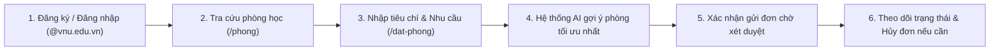
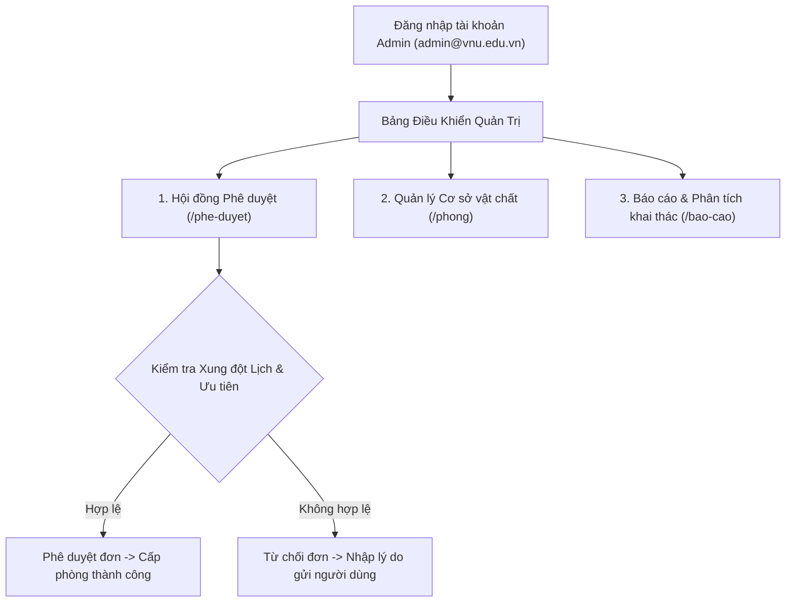

# Cẩm Nang Hướng Dẫn Sử Dụng Hệ Thống BookIn (VNU-IS)
> **Cổng Dịch Vụ Quản Lý & Đặt Phòng Học Trực Tuyến**  
> Đơn vị: Trường Quốc tế – Đại học Quốc gia Hà Nội (VNU-IS)  
> Đường dẫn hệ thống chính thức: [https://bookin-vnu-is.vercel.app/dang-nhap](https://bookin-vnu-is.vercel.app/dang-nhap)

---

## 1. Giới Thiệu & Danh Sách Tài Khoản Kiểm Thử

Hệ thống **BookIn** phục vụ nhu cầu tra cứu, đăng ký mượn phòng học, phòng máy tính, phòng hội thảo và phê duyệt lịch sử dụng cơ sở vật chất dành riêng cho cán bộ, giảng viên và sinh viên Trường Quốc tế (VNU-IS).

Để phục vụ công tác đánh giá, nghiệm thu và kiểm thử tính năng trên môi trường Production, hệ thống đã chuẩn bị sẵn các tài khoản mẫu sau:

| Vai trò | Email đăng nhập | Mật khẩu | Quyền hạn & Chức năng chính |
| :--- | :--- | :--- | :--- |
| **Quản trị viên (Admin)** | `admin@vnu.edu.vn` | `Admin@123` | Toàn quyền quản trị: Phê duyệt/từ chối đơn đặt phòng, quản lý danh mục phòng học, xem báo cáo thống kê & bảng xếp hạng khai thác. |
| **Giảng viên (Lecturer)** | `lecturer@vnu.edu.vn` | `Lecturer@123` | Đặt phòng giảng dạy/hội thảo, được ưu tiên xếp đầu hàng đợi xét duyệt, quyền đăng ký các phòng chuyên dụng VIP. |
| **Sinh viên (Student)** | `student@vnu.edu.vn` | `Student@123` | Đặt phòng học nhóm, phòng sinh hoạt câu lạc bộ; nhận gợi ý phòng tự động theo nhu cầu. |

> [!NOTE]  
> Tất cả tài khoản mới khi đăng ký bắt buộc phải sử dụng email có đuôi **`@vnu.edu.vn`**. Hệ thống sẽ từ chối các email thương mại như `@gmail.com`, `@yahoo.com`, v.v.

---

## 2. Quy Trình Dành Cho Sinh Viên & Giảng Viên

### Bước 1: Đăng Ký & Đăng Nhập
1. Truy cập liên kết: [https://bookin-vnu-is.vercel.app/dang-nhap](https://bookin-vnu-is.vercel.app/dang-nhap).
2. Nếu chưa có tài khoản:
   * Bấm vào liên kết **"Chưa có tài khoản? Đăng ký ngay"** (hoặc truy cập trực tiếp `/dang-ky`).
   * Điền đầy đủ thông tin: Họ và tên, Email VNU-IS (ví dụ: `nguyenvana@vnu.edu.vn`), Mật khẩu (tối thiểu 6 ký tự).
   * Lựa chọn vai trò: **Sinh viên** hoặc **Giảng viên**.
   * Chọn Khoa trực thuộc (Khoa CNTT & Kinh tế số, Khoa Kinh tế & Quản lý, Khoa Ngôn ngữ ứng dụng, v.v.).
   * Nhấn nút **"Đăng ký tài khoản"**.
3. Tại màn hình Đăng nhập: Nhập Email và Mật khẩu, bấm **"Đăng nhập hệ thống"**.

### Bước 2: Cập Nhật Hồ Sơ & Nhu Cầu Hỗ Trợ Di Chuyển (`/ho-so`)
1. Bấm vào tên người dùng ở góc trên bên phải hoặc chọn mục **"Hồ sơ cá nhân"** trên thanh menu điều hướng.
2. Kiểm tra thông tin chức danh, khoa và danh sách quyền hạn sử dụng phòng.
3. **Chính sách hỗ trợ di chuyển (Dành riêng cho Sinh viên & Giảng viên)**:
   * Nếu bạn gặp khó khăn về vận động (chấn thương chân, phải di chuyển bằng xe lăn hoặc nạng), hãy tích chọn vào ô **"Ưu tiên phòng thấp tầng / hỗ trợ di chuyển"**.
   * Khi kích hoạt, hệ thống thuật toán sẽ tự động ưu tiên tối đa các phòng học tại **Tầng 1** hoặc các phòng học **Tầng 2 có thang máy**, loại bỏ hoàn toàn các phòng trên tầng cao không có thang máy.

### Bước 3: Tra Cứu Danh Mục Phòng Học (`/phong`)
1. Bấm vào mục **"Danh sách phòng"** trên menu bên trái.
2. Sử dụng bộ lọc thông minh:
   * **Tòa nhà**: Tòa A1, Tòa A2, Tòa B3, Tòa C1.
   * **Sức chứa tối thiểu**: 20 chỗ, 40 chỗ, 60 chỗ, 100 chỗ.
   * **Trang thiết bị**: Máy chiếu (Projector), Micro âm thanh, Máy tính thực hành, Bảng viết, Thiết bị họp trực tuyến, Điều hòa.
3. Xem thông tin chi tiết từng phòng: Mã phòng, Tầng, Thang máy, Sức chứa, Trang thiết bị và Trạng thái vận hành (`Sẵn sàng` hoặc `Bảo trì`).

### Bước 4: Tạo Đơn Đặt Phòng & Nhận Đề Xuất Thông Minh (`/dat-phong`)
1. Chọn mục **"Đặt phòng"** trên menu.
2. **Nhập thông tin yêu cầu**:
   * **Ngày sử dụng**: Chọn ngày trong tuần (từ hôm nay trở đi).
   * **Khung giờ**: Chọn giờ bắt đầu và giờ kết thúc trong khung thời gian vận hành chuẩn từ **07:00 đến 21:00**.
   * **Số người tham gia**: Điền số lượng người dự kiến (ví dụ: 35 người).
   * **Mục đích sử dụng**: Ghi rõ mục đích (ví dụ: *"Thuyết trình đồ án tốt nghiệp nhóm 4"*, *"Sinh hoạt định kỳ CLB Lập trình"*).
   * **Trang thiết bị cần có**: Tích chọn các thiết bị bắt buộc.
   * **Nhu cầu tạm thời**: Nếu đang bị đau chân tạm thời trong đợt này, bạn có thể tích chọn bổ sung để hệ thống ưu tiên xếp phòng tầng thấp.
3. Bấm nút **"Tìm & Đề xuất phòng"**:
   * **Bảng Đề Xuất Tối Ưu**: Thuật toán phân tích chấm điểm 100 điểm sẽ xếp hạng các phòng đạt chuẩn cao nhất lên đầu. Mỗi phòng đều có **Điểm tương thích (%)** và phân tích lý do đề xuất rõ ràng.
   * **Danh sách phòng bị loại trừ (nếu có)**: Phía dưới hiển thị minh bạch các phòng không đạt yêu cầu kèm nguyên nhân (ví dụ: *Đã có người đặt trước*, *Sức chứa quá nhỏ*, hoặc *Không có thang máy*).
4. Chọn một phòng ưng ý trong danh sách đề xuất và bấm nút **"Xác nhận đặt phòng này"**.
5. Đơn đặt phòng sẽ chuyển vào hàng đợi xét duyệt với trạng thái `Đang chờ duyệt`.

### Bước 5: Theo Dõi & Quản Lý Đơn Đặt Cá Nhân
1. Các đơn bạn đã gửi sẽ hiển thị ngay tại mục danh sách đơn của bạn.
2. Ý nghĩa trạng thái đơn:
   * Đang chờ duyệt: Đơn đã vào hàng đợi của Ban quản lý, có thời hạn xử lý tự động trong vòng 48 giờ.
   * Đã phê duyệt: Đơn được duyệt chính thức, phòng đã được giữ lịch cho bạn.
   * Bị từ chối: Đơn không được phê duyệt. Di chuột hoặc xem lý do từ chối cụ thể của Quản trị viên.
   * Đã hủy: Đơn do bạn chủ động hủy hoặc đơn hết hạn chờ duyệt.
3. **Hủy đơn**: Nếu có thay đổi lịch trình, hãy bấm nút **"Hủy đơn"** để trả lại phòng trống cho các bạn sinh viên và thầy cô khác sử dụng.

---

## 3. Quy Trình Dành Cho Quản Trị Viên & Hội Đồng Phê Duyệt

### Bước 1: Tiếp Nhận & Phê Duyệt Hàng Đợi (`/phe-duyet`)
1. Đăng nhập bằng tài khoản Quản trị viên (`admin@vnu.edu.vn`).
2. Chọn mục **"Hội đồng xét duyệt"** trên thanh menu.
3. Hàng đợi hiển thị toàn bộ các đơn đang chờ xử lý theo cơ chế ưu tiên:
   * **Đơn của Giảng viên** được hệ thống tự động đưa lên đầu hàng đợi.
   * Các đơn cùng nhóm đối tượng được xếp theo thời gian nộp đơn sớm nhất.
4. **Phát hiện xung đột lịch thông minh**:
   * Nếu có hai đơn xin cùng một phòng và khung giờ chồng lấn nhau, hệ thống sẽ gắn nhãn cảnh báo đỏ **"Xung đột lịch"** để quản trị viên cân nhắc.
5. **Thao tác duyệt đơn**:
   * **Phê duyệt**: Bấm nút **"Phê duyệt"**. Hệ thống sẽ chốt giữ chỗ cho người đặt và tự động hủy hoặc cảnh báo các đơn xung đột phía sau.
   * **Từ chối**: Bấm nút **"Từ chối"**, nhập lý do cụ thể vào ô văn bản (ví dụ: *"Phòng ưu tiên tổ chức kỳ thi hết môn của Nhà trường"*, *"Bảo dưỡng hệ thống điều hòa"*) rồi bấm **"Xác nhận từ chối"**.

### Bước 2: Quản Lý Danh Mục Phòng Học (`/phong`)
1. Truy cập mục **"Danh sách phòng"**.
2. **Thêm phòng mới**: Bấm nút **"+ Thêm phòng học"** ở góc phải:
   * Điền Mã phòng (VD: `A2-601`), Tên phòng, Chọn Tòa nhà, Số tầng.
   * Tích chọn Thang máy (nếu có), nhập Sức chứa tối đa.
   * Tích chọn danh sách trang thiết bị đi kèm phòng.
   * Chọn loại phòng thường hoặc Phòng đặc biệt (Hội trường/Phòng VIP).
   * Bấm **"Lưu phòng"**.
3. **Cập nhật & Chuyển trạng thái**:
   * Quản trị viên có thể chuyển trạng thái phòng sang **"Đang bảo trì"** khi có sự cố kỹ thuật. Lúc này toàn bộ các đơn đặt phòng trong tương lai của phòng đó sẽ được hệ thống tự động cảnh báo/hủy an toàn.

### Bước 3: Khai Thác Dashboard Báo Cáo & Phân Tích (`/bao-cao`)
Truy cập mục **"Báo cáo & Phân tích"** để theo dõi hiệu suất không gian thời gian thực:

1. **4 Chỉ số KPI Vận hành**:
   * *Tổng đơn đặt phòng*: Quy mô nhu cầu sử dụng cơ sở vật chất.
   * *Đã phê duyệt*: Số lượng đơn đã được cấp quyền sử dụng.
   * *Đang chờ duyệt*: Khối lượng công việc cần Hội đồng xử lý.
   * *Từ chối / Tự hủy*: Tỷ lệ không đáp ứng nhu cầu.
2. **Biểu đồ Cột Phân bổ Nhu cầu Đặt phòng**:
   * **Tab "Khung giờ"**: Phân tích tần suất sử dụng theo từng ca học trong ngày (07–09h, 09–11h, 11–13h, 13–15h, 15–17h, 17–19h, 19–21h) giúp nhận diện khung giờ cao điểm để điều phối phòng.
   * **Tab "Ngày trong tuần"**: Phân tích mật độ sử dụng từ Thứ 2 đến Chủ nhật, hỗ trợ sắp xếp lịch bảo dưỡng vào các ngày thấp điểm.
   * Di chuột vào từng cột biểu đồ để xem chính xác số lượt đặt.
3. **Đồng hồ Đo Hiệu suất Tổng thể (Occupancy Gauge)**:
   * Hiển thị tỷ lệ lấp đầy tổng thể của toàn bộ khuôn viên trường (tính theo thời gian mở cửa 14 tiếng/ngày).
   * Thanh tiến trình gradient tự động đổi màu trực quan: Xanh lá (>70% hiệu suất cao), Xanh dương (30% - 70% ổn định), Cam (<30% thấp điểm).
4. **Bảng Xếp Hạng Khai Thác Phòng Học (Room Leaderboard)**:
   * Tự động vinh danh và xếp hạng các phòng học có số giờ sử dụng nhiều nhất và tỷ lệ lấp đầy cao nhất.
   * Gắn huy hiệu danh giá: **Huy hiệu Vàng (Top 1)**, **Huy hiệu Bạc (Top 2)**, **Huy hiệu Đồng (Top 3)**.

---

## 4. Các Quy Định & Lưu Ý Nghiệp Vụ Quan Trọng

1. **Quy định email `@vnu.edu.vn`**:
   * Mọi tài khoản không thuộc tên miền `@vnu.edu.vn` đều không thể đăng ký thành công vào hệ thống.
2. **Khung giờ vận hành chuẩn**:
   * Hệ thống chỉ chấp nhận các yêu cầu mượn phòng trong khung giờ mở cửa giảng đường: từ **07:00 đến 21:00** hàng ngày.
3. **Cơ chế Hết hạn tự động (48 giờ)**:
   * Để đảm bảo không bị chiếm dụng phòng ảo, các đơn đặt phòng ở trạng thái `pending` nếu sau 48 giờ chưa được Hội đồng phê duyệt sẽ được hệ thống tự động chuyển sang trạng thái `Đã hủy (Hết hạn duyệt)`.
4. **Phòng đặc biệt (Special Rooms)**:
   * Các hội trường lớn (B3) và phòng họp hội đồng chỉ dành riêng cho Giảng viên hoặc Sinh viên được cấp quyền đặc biệt từ Phòng Đào tạo / Công tác sinh viên.

---

## 5. Xử Lý Các Thắc Mắc Thường Gặp (FAQ)

* **Hỏi: Tôi là sinh viên, tại sao tôi không thấy tùy chọn "Ưu tiên phòng thấp tầng" trong tài khoản của Admin?**
  * *Trả lời*: Đây là thiết kế nghiệp vụ chuẩn (QA BUG-002). Tài khoản Quản trị viên là tài khoản điều hành hệ thống, không có nhu cầu mượn phòng học tập nên tính năng này được ẩn để đảm bảo giao diện gọn gàng, tập trung đúng nhiệm vụ quản trị.
* **Hỏi: Tôi đăng ký tài khoản nhưng báo lỗi "Email đăng ký phải thuộc tên miền @vnu.edu.vn"?**
  * *Trả lời*: Bạn vui lòng sử dụng tài khoản email sinh viên/cán bộ do ĐHQGHN cấp (ví dụ: `yourname@vnu.edu.vn`) để đăng ký.
* **Hỏi: Sau khi gửi đơn đặt phòng, bao lâu thì đơn được duyệt?**
  * *Trả lời*: Ban quản lý phòng học sẽ xem xét đơn của bạn trong vòng 24 - 48 giờ. Bạn có thể đăng nhập vào hệ thống bất kỳ lúc nào để theo dõi trực tiếp trạng thái đơn của mình.

